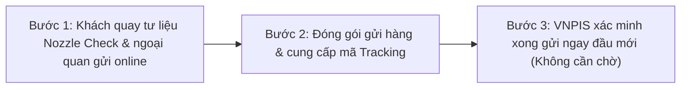

# Bảng Giá Đầu In Máy In Brother DTG (GTX, GTXpro, GTXpro Bulk) & Chính Sách 1 Năm 1 Đổi 1

Trong ngành in may mặc kỹ thuật số (Direct-to-Garment - DTG), dòng máy in **Brother GTX, GTXpro và GTXpro Bulk** được đánh giá là tiêu chuẩn vàng về độ phủ màu, độ chi tiết và tốc độ xả mực trên áo thun cotton, nỉ và vải sợi tổng hợp. Tuy nhiên, sau thời gian dài vận hành cường độ cao, chi phí thay thế đầu in luôn là gánh nặng tài chính lớn nhất của mọi xưởng in và doanh nghiệp gia công may mặc xuất khẩu.

Nhằm tháo gỡ rào cản chi phí và tối ưu hóa thời gian dừng máy (downtime), **VNPIS** chính thức công bố bảng giá và chương trình [đầu in Brother DTG chính hãng](https://vnpis.com/products/printheads/brother-gtx) với 2 phương án: **Refurbished (≥ 99% tia, bảo hành 1 năm 1 đổi 1 thu cũ đổi mới)** và **OEM New mới 100%**.

---

## 1. Bảng Báo Giá Đầu In Máy In Brother DTG Mới Nhất Tại VNPIS

Dưới đây là bảng báo giá chi tiết niêm yết áp dụng cho các xưởng in và nhà máy trên toàn quốc:

| Dòng Sản Phẩm | Hệ Mực In | Tỷ Lệ Tia (Nozzle) | Ngoại Quan | Tình Trạng Hàng | Giá Niêm Yết (USD) | Giá Quy Đổi (VNĐ) | Thời Hạn Bảo Hành |
| :--- | :--- | :---: | :---: | :---: | :---: | :---: | :--- |
| **Refurbished – Đầu in màu (Color)** | Brother DTG Pigment | $\ge 99\%$ tia | 90% – 97% | **Có sẵn hàng** | **1.550 USD** | **39.525.000 VNĐ** | **1 năm 1 đổi 1** *(Thu cũ đổi mới)* |
| **Refurbished – Đầu in trắng (White)** | Brother DTG Pigment | $\ge 99\%$ tia | 90% – 97% | **Có sẵn hàng** | **1.650 USD** | **42.160.000 VNĐ** | **1 năm 1 đổi 1** *(Thu cũ đổi mới)* |
| **OEM New – Đầu in màu (Color)** | Brother GTXpro xuất xưởng | Mới 100% | Mới 100% | *Sắp ra mắt* | *Liên hệ* | *Đang cập nhật* | Tiêu chuẩn nhà sản xuất |
| **OEM New – Đầu in trắng (White)** | Brother GTXpro xuất xưởng | Mới 100% | Mới 100% | *Sắp ra mắt* | *Liên hệ* | *Đang cập nhật* | Tiêu chuẩn nhà sản xuất |

> 📌 **Gợi ý lựa chọn:**
> * **Giải pháp Refurbished:** Là phương án tiết kiệm tối ưu, giảm hơn 40% chi phí đầu tư ban đầu nhưng vẫn đảm bảo chất lượng giọt mực và độ phủ tia đạt chuẩn $\ge 99\%$, đặc biệt được bảo vệ bởi cam kết bảo hành 1 năm 1 đổi 1.
> * **Giải pháp OEM New:** Phù hợp cho các xưởng yêu cầu phụ tùng nguyên seal xuất xưởng từ nhà sản xuất.

Quý khách hàng có thể xem thông số kỹ thuật chi tiết tại trang sản phẩm chuyên biệt: [Đầu in máy in Brother DTG GTX, GTXpro, GTXpro Bulk](https://vnpis.com/products/printheads/brother-gtx).

---

## 2. So Sánh Bài Toán Kinh Tế Giữa Refurbished Và Mua Mới Hoàn Toàn

Một xưởng in DTG vận hành 2 - 3 máy in Brother GTX trung bình thay thế từ 2 đến 4 đầu in mỗi năm (đặc biệt là đầu in mực trắng do đặc tính lắng đọng của Titanium Dioxide - $TiO_2$). 

### Bảng phân tích chi phí vận hành cho xưởng 2 máy Brother GTX:
- **Phương án mua mới hoàn toàn ngoài thị trường:** Chi phí dao động từ 2.400 – 2.800 USD/đầu in mới, không có cơ chế thu hồi linh kiện cũ, rủi ro mất bảo hành cao khi dùng mực ngoài.
- **Phương án Refurbished VNPIS với cơ chế Trade-in (Thu cũ đổi mới):** 
  - Chi phí chỉ từ **1.550 USD (Màu)** và **1.650 USD (Trắng)**.
  - Tiết kiệm ngay từ **800 – 1.200 USD mỗi lần thay thế**.
  - Tận dụng giá trị từ chiếc đầu in lỗi tưởng chừng phải bỏ đi để được hưởng **chính sách bảo hành 1 năm 1 đổi 1**.
  - Tổng chi phí phụ tùng vận hành của xưởng giảm tới **45% - 50%**, giúp hạ giá thành gia công trên từng áo và tăng biên lợi nhuận ròng.

---

## 3. Hai Chương Trình Bảo Hành Độc Quyền Tại VNPIS

Hiểu được tính chất sống còn của đầu in đối với dây chuyền sản xuất dệt may, VNPIS áp dụng hai gói bảo hành minh bạch:

### Gói 1: Có Mua Kèm Vật Tư (Mực in & Phụ tùng chính hãng VNPIS) - *Khuyên dùng*
* **Điều kiện:** Duy trì mua mực in dệt may định kỳ hàng tháng từ VNPIS theo định mức cam kết.
* **Thời hạn:** Bảo hành miễn phí toàn diện.
* **Phạm vi bảo vệ:** Hỗ trợ xử lý kỹ thuật, sửa chữa hoặc **đổi 1:1** ngay khi có phát sinh lỗi trong quá trình in ấn.
* **Lợi ích:** Triệt tiêu hoàn toàn rủi ro sử dụng mực kém chất lượng gây tắc nghẽn hoặc ăn mòn vi mạch điện tử.

### Gói 2: Không Mua Vật Tư (Chỉ mua riêng lẻ đầu in)
* **Điều kiện:** Khách hàng sử dụng nguồn mực in và phụ kiện trôi nổi bên ngoài.
* **Phạm vi bảo hành:** Bảo hành toàn bộ các lỗi liên quan đến **phần cứng bo mạch điện tử** của đầu in.
* **Loại trừ:** Không bảo hành đối với các trường hợp tắc nozzle, nghẽn dòng cấp mực hoặc vỡ/rò rỉ túi mực bên trong do áp suất và hóa chất tẩy rửa không phù hợp.

---

## 4. Quy Trình Đổi 1:1 Siêu Tốc – Gửi Ngay Đầu Mới Không Cần Chờ

Khác biệt hoàn toàn với quy trình bảo hành truyền thống làm đình trệ đơn hàng, VNPIS áp dụng **quy trình đổi 1:1 online tức thì**:

1. **Bước 1 – Quay tư liệu online theo chuẩn VNPIS:** Khách hàng quay video/ảnh hiện trạng đầu in, video in test tia Nozzle Check và ngoại quan theo đúng hướng dẫn kỹ thuật của VNPIS gửi online qua Zalo.
2. **Bước 2 – Đóng gói & Cung cấp mã vận đơn (Tracking):** Khách hàng quay video đóng gói an toàn và gửi mã vận đơn (Tracking number của đơn vị chuyển phát hoặc biên nhận gửi chành xe) xác nhận đã bàn giao đầu in lỗi đi.
3. **Bước 3 – Xác minh online & Gửi ngay đầu mới:** Kỹ thuật VNPIS xác minh online tư liệu và mã tracking. Duyệt xong là **xuất kho gửi ngay đầu in mới/đạt chuẩn trả khách lập tức mà KHÔNG CẦN CHỜ đầu cũ về đến kho**! *(Cước phí vận chuyển do bên nhận chịu cho cả chiều gửi và chiều nhận).*

---

## 5. Tiêu Chuẩn & Điều Khoản Bảo Hành Minh Bạch

Để đảm bảo tính công bằng và chuyên nghiệp, mọi đầu in tham gia chương trình bảo hành đều được thẩm định theo các tiêu chí:

* **Điều kiện hợp lệ được bảo hành:**
  * Đầu in còn nguyên tem niêm phong, không bị nứt vỡ, móp méo, trầy xước bề mặt vòi phun kim loại.
  * Không có dấu hiệu tự ý tháo mở ốc vít, can thiệp hoặc sửa chữa bởi bên thứ ba.
* **Trường hợp từ chối bảo hành:**
  * Chập cháy do xung điện bên ngoài hoặc bo mạch chính của máy in bị quá áp.
  * Hư hỏng vật lý do người vận hành va chạm trong quá trình căn chỉnh cự ly gạt mực.
  * Tắc tia do sử dụng mực cặn, mực hết hạn hoặc pha trộn dung môi rửa không đúng quy chuẩn Brother.
  * Sự cố bất khả kháng như hỏa hoạn, ngập nước, chập điện diện rộng.

---

## 6. Liên Hệ Tư Vấn & Nhận Báo Giá Trực Tiếp

Đội ngũ kỹ sư VNPIS sẵn sàng hỗ trợ kiểm tra tình trạng đầu in cũ, đo test tia tại chỗ và tư vấn giải pháp trade-in phù hợp nhất:

* **Xem sản phẩm và đặt mua:** [Đầu in Brother DTG (GTX, GTXpro, GTXpro Bulk)](https://vnpis.com/products/printheads/brother-gtx)
* **Danh mục linh kiện đầu phun công nghiệp:** [VNPIS Printheads](https://vnpis.com/products/printheads)
* **Hotline hỗ trợ kỹ thuật 24/7:** **0987 453 866**
* **Website:** [https://vnpis.com](https://vnpis.com)
