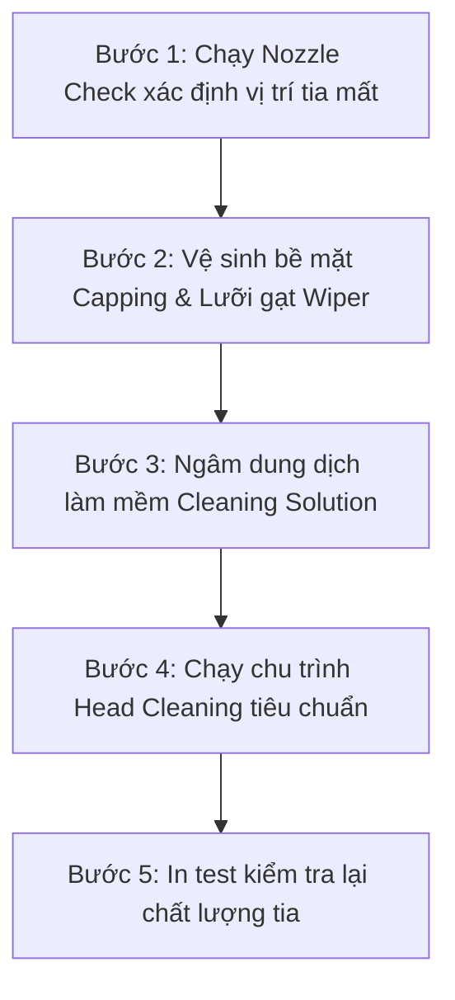

# Hướng Dẫn Bảo Dưỡng, Xử Lý Lỗi Tắc Tia Đầu In Brother DTG GTX & Giải Pháp Phục Hồi Thu Cũ Đổi Mới

Máy in dệt may trực tiếp (DTG - Direct to Garment) **Brother GTX, Brother GTXpro và GTXpro Bulk** là dòng máy in áo thun hàng đầu thế giới nhờ độ sắc nét và tốc độ vượt trội. Tuy nhiên, bất kỳ xưởng in nào sử dụng dòng máy này cũng từng đối mặt với hiện tượng: **mất tia (missing nozzles), bản in sọc trắng, màu in bị sai lệch hoặc đầu in trắng tắc hoàn toàn sau một thời gian nghỉ in**.

Bài viết này được biên soạn bởi **Kỹ Sư Trưởng Lưu Trọng Tâm** cùng đội ngũ kỹ thuật VNPIS, chia sẻ chi tiết nguyên nhân gốc rễ, quy trình SOP bảo dưỡng chuẩn phòng Lab và giải pháp **thu cũ đổi mới đầu in Brother DTG tiết kiệm đến 50% chi phí** khi đầu in không còn khả năng phục hồi thủ công.

---

## 1. Nguyên Nhân Khiến Đầu In Brother DTG Bị Tắc Tia & Nghẹt Mực

### A. Bản chất hóa lý của mực dệt may gốc nước (Textile Pigment Ink)
Khác với mực Solvent hay mực UV, mực in DTG chứa các hạt phân tử màu hữu cơ siêu mịn được treo lơ lửng trong môi trường nước cùng chất kết dính (binder) và nhựa acrylic. 
- **Đối với đầu in màu (CMYK):** Các hạt màu dễ bị bay hơi dung môi ở miệng lỗ phun nếu nắp đậy (capping station) bị hở gioăng hoặc máy in đặt trong môi trường độ ẩm thấp (< 40%).
- **Đối với đầu in trắng (White Ink):** Mực trắng sử dụng hạt oxit titan ($TiO_2$) có khối lượng riêng nặng hơn nước rất nhiều. Khi máy nghỉ hoặc tuần hoàn mực không đủ áp, các hạt oxit titan sẽ lắng xuống đáy buồng mực, tạo thành lớp kết tủa đông đặc làm bít tắc hoàn toàn hệ thống túi mực (damper) và vi ống dẫn thạch anh Piezo.

### B. Các yếu tố cơ khí và môi trường vận hành
1. **Lưỡi gạt cao su (Wiper Blade) bị mòn hoặc đóng cặn khô:** Khi gạt qua bề mặt kim loại, lưỡi gạt bẩn sẽ miết cặn ngược vào trong lỗ vòi phun thay vì làm sạch.
2. **Nắp ủ đầu in (Maintenance Cap) bị rò rỉ khí:** Khiến môi trường dưỡng ẩm bị khô cứng, tạo thành màng mực dẻo bít kín lỗ xả tia.
3. **Sử dụng dung môi rửa không tương thích:** Nhiều thợ in sử dụng cồn công nghiệp hoặc chất tẩy mạnh, làm bong lớp mạ kỵ nước (hydrophobic coating) trên bề mặt đầu in, dẫn đến hiện tượng tia bắn xiên và nhỏ giọt.

---

*Hình ảnh thực tế kiểm tra thiết bị tại xưởng VNPIS (Hotline/Zalo kỹ thuật: 0987.453.866)*

## 2. Quy Trình SOP 5 Bước Làm Sạch & Phục Hồi Đầu In Brother GTX Tại Xưởng

Nếu đầu in của bạn mới chỉ mất vài tia, hãy tuân thủ quy trình bảo dưỡng tiêu chuẩn sau:

* **Bước 1 – Đánh giá tình trạng:** In bản test tia `Nozzle Check` để xác định chính xác số lượng tia tắc và kênh màu bị ảnh hưởng.
* **Bước 2 – Làm sạch cơ học:** Dùng que tăm bông bọt biển (Foam Swab) chuyên dụng thấm dung dịch bảo dưỡng Brother Cleaning Solution, nhẹ nhàng lau sạch viền xung quanh nắp capping và mép lưỡi gạt wiper. Tuyệt đối không chạm mạnh vào mặt kim loại của vòi phun.
* **Bước 3 – Ủ đầu in (Cap Soaking):** Nhỏ 5–10 giọt dung dịch làm mềm vào khay capping, đưa cụm đầu in về vị trí Home và ngâm từ 30 – 60 phút để hòa tan các cặn mực khô.
* **Bước 4 – Làm sạch bằng lệnh máy:** Thực hiện chu trình `Normal Clean` hoặc `Powerful Clean`. Lưu ý: Không nên lạm dụng lệnh `Powerful Clean` quá 3 lần liên tiếp để tránh áp suất âm làm rách túi mực bên trong.
* **Bước 5 – Đánh giá phục hồi:** In lại bản Nozzle Check. Nếu các tia đã phục hồi đều, tiếp tục sản xuất bình thường.

---

## 3. Khi Nào Đầu In Không Thể Cứu Được Nữa?

Thực tế kỹ thuật tại Lab VNPIS cho thấy, trong các trường hợp sau, việc tiếp tục ngâm dung dịch hoặc ép áp lực bơm xả sẽ chỉ làm hư hỏng nặng thêm:
1. **Rách màng túi mực (Damper Rupture):** Mực bị rò rỉ tràn ra ngoài bo mạch điện tử, gây đoản mạch hoặc báo lỗi cảm biến áp suất.
2. **Cháy buồng rung Piezo thạch anh:** Tín hiệu điều khiển điện vẫn phát nhưng vòi phun không thể nảy hạt mực do lớp gốm áp điện bị nứt vỡ.
3. **Tắc vón cục Titan Dioxide ($TiO_2$) hóa thạch:** Mực trắng để quên trong máy quá 2 tuần không tuần hoàn đã đông cứng thành khối rắn bên trong vi mạch dẫn mực.
4. **Mặt gương kim loại bị trầy xước:** Do áo va đập hoặc cọ sát vào bàn in trong lúc in tốc độ cao.

Khi gặp các tình trạng trên, việc cố gắng sửa chữa sẽ tiêu tốn thời gian vô ích và gây trễ đơn hàng gia công của xưởng.

---

## 4. Giải Pháp Thu Cũ Đổi Mới (Trade-in) Đầu In Brother DTG Tại VNPIS

Thay vì phải chi ra số tiền lớn từ 2.400 – 2.800 USD để mua một đầu in mới toanh mà vẫn lo lắng về rủi ro vận hành, VNPIS cung cấp giải pháp **[Đầu in máy in Brother DTG Refurbished chính hãng](https://vnpis.com/products/printheads/brother-gtx)**:

* **Tỷ lệ tia hoàn hảo:** Kiểm định bằng kính hiển vi và máy đo xung sóng, đảm bảo $\ge 99\%$ tia xả mực tròn đều.
* **Mức giá siêu tiết kiệm:** 
  * **Đầu in màu (Color):** Chỉ **1.550 USD** *(39.525.000 VNĐ)*.
  * **Đầu in trắng (White):** Chỉ **1.650 USD** *(42.160.000 VNĐ)*.
* **Chính sách bảo hành 1 năm 1 đổi 1:** Khi tham gia chương trình thu hồi đầu cũ, quý khách được cấp chứng nhận bảo hành 1 năm, an tâm tuyệt đối về chất lượng.
* **Thời gian đáp ứng siêu tốc:** Xác minh video online và mã tracking gửi hàng là VNPIS gửi ngay đầu in mới trả khách, không cần chờ đầu cũ về kho!

---

## 5. Hướng Dẫn Kéo Dài Tuổi Thọ Đầu In Brother DTG Lên Trên 3 Năm

Để đầu in luôn hoạt động ở trạng thái đỉnh cao và tránh tình trạng mất tia tái diễn, hãy áp dụng các nguyên tắc vàng:
- **Duy trì độ ẩm phòng in:** Độ ẩm lý tưởng từ 50% – 65%, nhiệt độ phòng từ 20°C – 28°C.
- **Lắc hộp mực trắng mỗi sáng:** Thao tác lắc đều hộp mực trắng trước khi mở máy giúp phân tán đều các hạt $TiO_2$.
- **Bảo trì nắp Capping & Lưỡi gạt hàng ngày:** Vệ sinh cặn mực bám sau mỗi ca làm việc bằng dung dịch chính hãng.
- **Sử dụng mực in chất lượng:** Không pha tạp mực không rõ nguồn gốc. Khách hàng sử dụng mực dệt may từ VNPIS sẽ được hưởng gói bảo hành miễn phí toàn diện theo chương trình [bảo hành đầu in Brother DTG](https://vnpis.com/products/printheads/brother-gtx#warranty-policy).

---

## 6. Liên Hệ Kỹ Thuật & Đăng Ký Kiểm Tra Đầu In Miễn Phí

Nếu máy in Brother GTX của bạn đang gặp hiện tượng mất tia, sọc bản in hoặc cần kiểm tra tình trạng đầu in cũ, hãy liên hệ ngay với đội ngũ kỹ sư VNPIS:

* **Trang sản phẩm & chính sách:** [Đầu In Máy In Brother DTG (GTX / GTXpro / GTXpro Bulk)](https://vnpis.com/products/printheads/brother-gtx)
* **Xem toàn bộ danh mục đầu phun:** [VNPIS Industrial Printheads](https://vnpis.com/products/printheads)
* **Kỹ Sư Trưởng hỗ trợ 24/7:** **0987 453 866** (Zalo / Hotline)
* **Email:** contact@vnpis.com
* **Địa chỉ:** Lab Kỹ Thuật VNPIS, TP. Hồ Chí Minh
