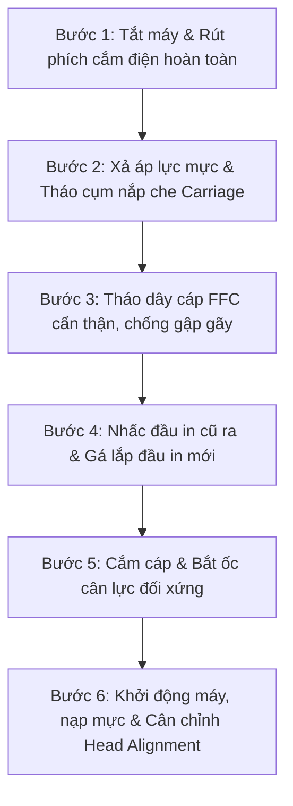

# Hướng Dẫn Từng Bước Tự Thay Thế & Căn Chỉnh Đầu In Máy In Brother GTX, GTXpro Chuẩn Kỹ Sư

Tự thay thế đầu in tại xưởng là một kỹ năng vô cùng hữu ích giúp các chủ xưởng in DTG chủ động khôi phục sản xuất ngay trong đêm hoặc những ngày nghỉ mà không phải phụ thuộc vào kỹ thuật viên bên ngoài. Tuy nhiên, cụm đầu in của máy in áo thun **Brother GTX và GTXpro** là linh kiện vi cơ điện tử có giá trị cao và cực kỳ nhạy cảm với tĩnh điện cũng như chạm chập chân cáp tín hiệu.

Chỉ một sơ suất nhỏ như **quên ngắt nguồn điện, cắm lệch cáp FFC (Flat Flexible Cable) hoặc để mực rò rỉ vào chân tiếp xúc** có thể làm cháy toàn bộ bo mạch Carriage Board hoặc Mainboard chính của máy in.

Dưới đây là quy trình SOP chuẩn được đúc kết bởi **Kỹ Sư Trưởng Lưu Trọng Tâm** từ VNPIS, giúp kỹ thuật viên tại xưởng thao tác an toàn 100%.

---

## 1. Dụng Cụ Cần Chuẩn Bị Trước Khi Thao Tác

Trước khi tiến hành, hãy chuẩn bị đầy đủ các thiết bị sau tại khu vực khô ráo, sạch sẽ:
1. **Đầu in thay thế đạt chuẩn:** [Đầu in Brother DTG Refurbished hoặc OEM New](https://vnpis.com/products/printheads/brother-gtx) có tem thông số Head Rank đi kèm.
2. **Bộ tua vít bake chuyên dụng:** Kích thước PH1 và PH2 có đầu từ tính.
3. **Vòng đeo tay chống tĩnh điện (ESD Wrist Strap):** Hoặc tiếp đất cơ thể trước khi chạm vào bo mạch.
4. **Khăn lau phòng sạch không bụi (Cleanroom Wipes) & Que lau bọt biển (Foam Swabs).**
5. **Dung dịch bảo dưỡng chuyên dụng:** Brother Cleaning Solution hoặc dung dịch rửa gốc nước trung tính.
6. **Găng tay cao su y tế (Nitrile Gloves):** Chống dính mực và dầu mỡ tay lên bề mặt nozzle.

---
## 2. Quy Trình 6 Bước Thay Thế Đầu In Chuẩn Kỹ Thuật VNPIS

### Bước 1: Ngắt toàn bộ nguồn điện (Quy tắc an toàn tuyệt đối)
- Tắt công tắc máy in và **rút hẳn dây nguồn ra khỏi ổ cắm**.
- Nhấn giữ nút nguồn thêm 5 giây để xả hết điện áp tĩnh tích tụ trong các tụ điện của bo mạch chính.

### Bước 2: Di chuyển cụm đầu in và tháo vỏ bảo vệ
- Xoay nhẹ bánh răng cơ khí để nhả khóa cụm Carriage khỏi nắp Capping Station, sau đó kéo nhẹ cụm đầu in ra giữa bàn in.
- Tháo các ốc vít cố định nắp che bảo vệ cụm đầu in.

### Bước 3: Tháo ống dẫn mực & dây cáp tín hiệu FFC
- Kẹp khóa ống dẫn mực để tránh mực chảy tràn do chênh lệch độ cao.
- Dùng tay rút nhẹ nhàng các sợi cáp FFC theo phương thẳng đứng. **Tuyệt đối không giật chéo hoặc lay mạnh**, tránh làm tróc chân mạ vàng của đầu cáp.
- Kiểm tra đầu cáp: Nếu phát hiện có vết mực ẩm bám vào chân cáp, phải dùng cồn Isopropyl Alcohol (IPA) sấy khô hoàn toàn trước khi tái sử dụng.

### Bước 4: Tháo đầu in cũ và lắp đầu in mới
- Tháo 3 hoặc 4 ốc gá cố định đế đầu in. Nhấc đầu in cũ ra và đóng gói vào hộp để tham gia [chương trình thu cũ đổi mới VNPIS](https://vnpis.com/blog/quy-trinh-thu-cu-doi-moi-dau-in-brother-gtx-vnpis).
- Đặt đầu in mới vào đúng các chốt định vị cơ khí (Guide Pins). Bắt ốc nhẹ tay theo hình chữ X, sau đó siết chặt đều tay để tránh làm vênh mặt gá.

### Bước 5: Cắm lại cáp tín hiệu và gắn ống mực
- Cắm các dải cáp FFC ngập sâu và đều vào khe cắm trên bo mạch đầu in.
- Lắp lại ống dẫn mực và mở kẹp khóa.

### Bước 6: Khởi động máy, nạp mực & Cân chỉnh tia
- Cắm nguồn và bật máy in.
- Vào menu bảo trì trên màn hình điều khiển: Chọn lệnh `Initial Ink Charge` hoặc `Head Cleaning` để hút mực điền đầy vào buồng thạch anh của đầu in mới.

---

## 3. Cài Đặt Mã Head Rank ID & Cân Chỉnh Góc Nghiêng (Head Alignment)

Một sai lầm rất phổ biến là: Sau khi lắp xong, thợ in cho in ngay mà **quên nhập mã Head Rank ID**, dẫn đến giọt mực bị bay xiên hoặc độ phủ màu không chuẩn.

### A. Nhập mã Head Rank ID
Mỗi đầu in Brother chính hãng đều mang một dải mã vạch chứa thông số điện áp kích hoạt sóng Piezo riêng biệt do nhà máy tinh chỉnh.
- Mở phần mềm quản trị kỹ thuật `Brother Maintenance Utility` trên máy tính kết nối.
- Nhập chính xác dãy số ký tự Head Rank được in trên tem nhãn của đầu in mới và nhấn `Write to ROM`.

### B. Căn chỉnh tia tự động (Alignment Test)
- Đặt một tờ giấy trắng dày hoặc áo mẫu lên bàn in.
- Chọn lệnh `Print Alignment Pattern`.
- Đọc kết quả các vạch kẻ màu: Chọn số tương ứng với vạch kẻ thẳng nhất, không bị đứt đoạn và nhập vào máy để hệ thống tự bù trừ bước dịch chuyển của motor bước.

---

## 4. Những Sai Lầm Nguy Hiểm Cần Tuyệt Đối Tránh

* ⚠️ **Chạm tay trực tiếp vào mặt gương kim loại chứa vòi phun:** Dầu nhờn và mồ hôi tay có tính axit nhẹ sẽ ăn mòn lớp phủ kỵ nước.
* ⚠️ **Lắp cáp khi máy còn cắm điện:** Khiến dòng điện 24V/42V phóng trực tiếp vào chân tín hiệu logic 3.3V, gây chết tức thì chip xử lý trung tâm.
* ⚠️ **Siết ốc quá chặt một bên:** Làm biến dạng mặt phẳng tiếp xúc, khiến đầu in bị nghiêng góc so với bàn in, gây ra hiện tượng nét in mờ một bên.

---

## 5. Hỗ Trợ Kỹ Thuật Lắp Đặt Tận Nơi Từ VNPIS

Nếu xưởng của bạn chưa có kỹ thuật viên cứng tay nghề hoặc e ngại rủi ro chập cháy bo mạch đắt tiền, **VNPIS cung cấp dịch vụ giao hàng, lắp đặt và cân chỉnh đầu in tận nơi trên toàn quốc**:
- Hướng dẫn chuyển giao kỹ thuật tận xưởng cho thợ in.
- Đo kiểm chất lượng bản in thực tế trước khi bàn giao.
- Áp dụng đầy đủ chính sách **bảo hành 1 năm 1 đổi 1** độc quyền.

* **Hotline hỗ trợ kỹ thuật 24/7:** **0987 453 866**
* **Trang sản phẩm:** [Đầu In Brother DTG (GTX / GTXpro / GTXpro Bulk)](https://vnpis.com/products/printheads/brother-gtx)
* **Bảng giá cập nhật:** [Báo Giá Đầu In Máy In Brother DTG](https://vnpis.com/blog/bang-gia-dau-in-brother-dtg-gtx-gtxpro-chinh-hang)
