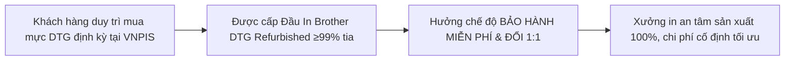

# Kinh Nghiệm Chọn Mực In DTG Cho Brother GTX & Quyền Lợi Gói Bảo Hành Đầu In Miễn Phí Tại VNPIS

Trong chuỗi cung ứng in may mặc xuất khẩu, **mực in dệt may kỹ thuật số (DTG Ink)** và **đầu in phun (Printhead)** là hai yếu tố có mối quan hệ cộng sinh mật thiết. Một chiếc đầu in trị giá hàng chục triệu đồng có thể bị hủy hoại chỉ trong vài tuần nếu xưởng in sử dụng mực trôi nổi kém chất lượng. Ngược lại, một dòng mực cao cấp tương thích chuẩn xác sẽ giúp đầu in vận hành bền bỉ trên 3–5 năm mà không hề bị tắc tia.

Tuy nhiên, trước sức ép cạnh tranh về giá gia công áo thun, nhiều chủ xưởng đã mạo hiểm chọn mua các loại mực giá rẻ không rõ nguồn gốc, để rồi phải trả cái giá rất đắt khi đầu in bị nghẹt cặn và bị các hãng phân phối từ chối bảo hành.

Bài viết này do **Kỹ Sư Trưởng Lưu Trọng Tâm** từ VNPIS phân tích sâu về tiêu chuẩn chọn mực DTG an toàn và hé lộ **Gói Giải Pháp Toàn Diện: Mua Mực VNPIS – Nhận Ngay Bảo Hành Đầu In Miễn Phí & Đổi 1:1**.

---

## 1. Mực In DTG Chuẩn Dành Cho Brother GTX Cần Đáp Ứng Những Tiêu Chuẩn Nào?

Máy in Brother GTX và GTXpro sử dụng công nghệ đầu phun áp điện Piezo độc quyền với tần số xả mực siêu cao và kích thước giọt mực biến đổi cực nhỏ. Do đó, mực in bắt buộc phải vượt qua các chỉ số hóa lý khắt khe:

### A. Kích thước hạt sắc tố siêu mịn (Nano-Pigment Size < 100nm)
- Các lỗ vòi phun của đầu in Brother có đường kính chỉ khoảng $20 - 30\,\mu m$.
- Nếu mực in sử dụng công nghệ nghiền thô, các hạt màu có kích thước trên $0.2\,\mu m$ hoặc độ phân tán không đồng đều sẽ nhanh chóng kết tụ lại, gây tắc nghẽn cục bộ các vi ống dẫn thạch anh Piezo.

### B. Độ nhớt (Viscosity) và Sức căng bề mặt (Surface Tension) chuẩn xác
- **Độ nhớt tiêu chuẩn:** Phải nằm trong khoảng **3.5 – 5.5 mPa·s** ở nhiệt độ 25°C. Nếu mực quá đặc, bơm không thể hút mực kịp tốc độ in cao; nếu quá lỏng, mực sẽ bị nhỏ giọt (dripping) lem bẩn áo.
- **Sức căng bề mặt:** Đạt ngưỡng **28 – 35 mN/m** để đảm bảo hình thái giọt mực bay tròn đều, không bị văng bụi mực (overspray).

### C. Chứng nhận an toàn quốc tế cho hàng may mặc (Oeko-Tex Standard 100 & GOTS)
- Hàng may mặc xuất khẩu sang thị trường Mỹ, EU hay Nhật Bản đều kiểm tra nghiêm ngặt dư lượng kim loại nặng, Phthalates, Formaldehyde và hợp chất hữu cơ dễ bay hơi (VOC).
- Mực DTG đạt chuẩn Oeko-Tex Eco Passport bảo đảm an toàn tuyệt đối cho cả đồ sơ sinh và trẻ em.

---

## 2. Những Hậu Quả Khôn Lường Khi Dùng Mực DTG Trôi Nổi Giá Rẻ

Nhiều xưởng in chỉ nhìn vào con số tiết kiệm được vài trăm nghìn đồng trên mỗi lít mực mà không lường trước các rủi ro kỹ thuật:
1. **Lắng đọng cặn vôi $TiO_2$ hóa thạch:** Mực trắng giá rẻ thiếu các chất hoạt động bề mặt chuyên dụng, khiến oxit titan kết tủa thành cặn rắn phá hủy buồng thạch anh.
2. **Ăn mòn màng túi mực (Damper Rupture):** Dung môi công nghiệp giá rẻ có tính axit hoặc kiềm mạnh sẽ ăn mòn lớp keo gắn và màng cao su, gây rò rỉ mực tràn vào bo mạch điện tử, làm nổ cầu chì và chết Mainboard.
3. **Mất hoàn toàn quyền bảo hành:** Tất cả các nhà sản xuất máy in đều từ chối bảo hành nếu phát hiện khách hàng sử dụng mực không được chứng nhận.

---

## 3. Đặc Quyền Độc Nhất Vô Nhị: Gói Bảo Hành Đầu In Miễn Phí Tại VNPIS

Để giải quyết triệt để nỗi lo hỏng đầu in và chi phí vật tư của khách hàng, VNPIS mang đến chính sách đột phá: **"Đồng Hành Vật Tư – Bảo Vệ Đầu In Trọn Gói"**:

### Chi tiết quyền lợi Chương trình 1 (Có Mua Vật Tư):
* **Điều kiện duy trì:** Khách hàng ký cam kết duy trì định mức mua mực in dệt may chính hãng tối thiểu hàng tháng tại VNPIS.
* **Quyền lợi bảo hành:**
  * **Miễn phí bảo hành toàn diện:** Bao gồm cả sửa chữa kỹ thuật và **đổi 1:1** khi đầu in gặp sự cố hoạt động.
  * Ưu tiên kỹ thuật viên kiểm tra, cân chỉnh máy in định kỳ tận nơi tại xưởng.
  * Hạn chế tối đa thời gian dừng chuyền: Có sẵn đầu in dự phòng đổi ngay trong vòng 24 giờ.

### So sánh với Chương trình 2 (Khách hàng không mua vật tư):
* Khách hàng chỉ mua riêng lẻ [Đầu in Brother DTG](https://vnpis.com/products/printheads/brother-gtx) tại VNPIS: Giá vẫn ưu đãi chỉ từ **1.550 USD (Màu)** và **1.650 USD (Trắng)**.
* Tuy nhiên, phạm vi bảo hành chỉ áp dụng cho **lỗi phần cứng bo mạch điện**; loại trừ lỗi tắc vòi phun và rách túi mực do rủi ro mực bên ngoài gây ra.

---

## 4. Dòng Mực In Dệt May DTG Được VNPIS Phân Phối Có Gì Nổi Bật?

* **Gam màu rộng (Wide Color Gamut):** Tái tạo trung thực các tông màu pastel, màu da người và các chi tiết chuyển sắc gradient mượt mà.
* **Độ bền giặt tuyệt hảo:** Đạt cấp độ 4–5 theo tiêu chuẩn AATCC sau 50 chu kỳ giặt máy, không bong tróc, không nứt rạn màng in khi kéo giãn sợi vải.
* **Đầy đủ chứng chỉ xuất khẩu:** Cung cấp đầy đủ bảng phân tích an toàn hóa chất MSDS, chứng nhận RoHS và Oeko-Tex Eco Passport phục vụ kiểm toán nhà máy xuất khẩu.

---

## 5. Nhận Tư Vấn & Đăng Ký Tham Gia Gói Bảo Trợ Vật Tư VNPIS

Hãy biến chi phí đầu in bất định thành một khoản ngân sách sản xuất cố định, có thể dự báo và kiểm soát 100%:

* **Xem trang sản phẩm:** [Đầu In Máy In Brother DTG (GTX / GTXpro / GTXpro Bulk)](https://vnpis.com/products/printheads/brother-gtx)
* **Bảng giá chi tiết:** [Bảng Giá Đầu In Brother DTG & Chính Sách 2 Năm 1 Đổi 1](https://vnpis.com/blog/bang-gia-dau-in-brother-dtg-gtx-gtxpro-chinh-hang)
* **Quy trình đổi trả:** [Quy Trình Thu Cũ Đổi Mới Đầu In Brother GTX](https://vnpis.com/blog/quy-trinh-thu-cu-doi-moi-dau-in-brother-gtx-vnpis)
* **Hotline hỗ trợ vật tư & kỹ thuật 24/7:** **0987 453 866**
* **Văn phòng & Lab Kỹ thuật:** VNPIS, TP. Hồ Chí Minh
