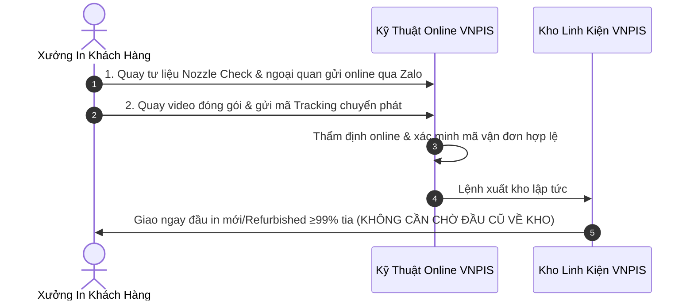

# Quy Trình Thu Cũ Đổi Mới Đầu In Brother GTX Tiết Kiệm Đến 50% Chi Phí: Hướng Dẫn Chi Tiết A-Z

Một trong những trăn trở lớn nhất của các xưởng in áo thun DTG khi đầu in bị tắc nghẽn hoặc hỏng là: **Linh kiện cũ hỏng này có thể tận dụng được gì không, hay bắt buộc phải vứt bỏ và mua một chiếc đầu in mới đắt đỏ?**

Thấu hiểu bài toán tối ưu chi phí của các doanh nghiệp in dệt may, **VNPIS** là đơn vị tiên phong tại Việt Nam triển khai chương trình **Thu Cũ Đổi Mới (Trade-in Service) dành riêng cho đầu in máy in Brother DTG (GTX, GTXpro, GTXpro Bulk)**. Giải pháp này giúp các chủ xưởng tận dụng tối đa giá trị xác linh kiện cũ để đổi lấy đầu in đạt chuẩn kỹ thuật $\ge 99\%$ tia với mức giá ưu đãi và chế độ **bảo hành 1 năm 1 đổi 1**.

Dưới đây là cẩm nang hướng dẫn toàn diện từ A–Z về điều kiện tham gia, quy trình tiếp nhận và phương thức vận chuyển.

---

## 1. Chương Trình Trade-in Đầu In Brother DTG Hoạt Động Như Thế Nào?

Chương trình thu cũ đổi mới tại VNPIS tuân thủ nguyên tắc:
$$\text{Chi Phí Thực Tế} = \text{Giá Đầu In Refurbished Ưu Đãi} - \text{Giá Trị Thu Hồi Xác Đầu In Cũ}$$

* **Đầu in màu (Color):** Giá trọn gói chỉ còn **1.550 USD** *(~39.525.000 VNĐ)*.
* **Đầu in trắng (White):** Giá trọn gói chỉ còn **1.650 USD** *(~42.160.000 VNĐ)*.
* **Đặc quyền bảo vệ:** Nhận ngay cam kết **bảo hành 1 năm 1 đổi 1** độc quyền tại VNPIS.

Thông tin chi tiết sản phẩm xem tại: [Đầu In Máy In Brother DTG](https://vnpis.com/products/printheads/brother-gtx).

---

## 2. Tiêu Chuẩn Tiếp Nhận Đầu In Cũ Đủ Điều Kiện Tham Gia Chương Trình

Để tham gia chương trình thu cũ đổi mới, chiếc đầu in Brother cũ của quý khách cần đáp ứng các tiêu chuẩn kỹ thuật cơ bản sau:

### ✅ Điều kiện ĐƯỢC CHẤP NHẬN thu hồi:
1. **Linh kiện chính hãng:** Là đầu in nguyên bản sản xuất cho máy in Brother DTG GTX, GTXpro hoặc GTXpro Bulk.
2. **Không biến dạng cơ học nặng:** Thân vỏ đầu in, các chốt định vị và khung gá bắt ốc không bị nứt vỡ toác hoặc cong vênh do va chạm cơ khí nghiêm trọng.
3. **Mặt gương nozzle kim loại:** Không bị cày xước sâu hoặc thủng rách do dao cạo sắc nhọn tác động.
4. **Tình trạng bo mạch:** Bo mạch điều khiển trên đầu in chưa từng bị cháy nổ than hóa toàn bộ.

### ❌ Trường hợp KHÔNG ĐỦ ĐIỀU KIỆN thu hồi:
- Đầu in đã bị tháo rã vụn linh kiện bên trong, mất nắp seal hoặc mất chip nhận diện.
- Đầu in bị ngâm trong hóa chất axit/bazơ ăn mòn phá hủy toàn bộ cấu trúc thạch anh.
- Linh kiện hàng nhái không rõ nguồn gốc.

---

## 3. Quy Trình 3 Bước Siêu Tốc – Gửi Ngay Không Cần Chờ

Điểm đột phá lớn nhất tại VNPIS là cơ chế **Instant Dispatch (Xuất kho ngay sau khi xác minh online)**, giúp xưởng in không bị gián đoạn đơn hàng:

### Bước 1: Khách hàng quay tư liệu theo chuẩn VNPIS gửi online
- Khách hàng quay video test tia `Nozzle Check` thể hiện rõ các kênh màu bị mất tia hoặc tắc dòng mực.
- Quay video cận cảnh ngoại quan đầu in, tem số series và mặt gương vòi phun.
- Gửi toàn bộ video và ảnh chụp cho đội ngũ kỹ thuật VNPIS qua Zalo Hotline tiếp nhận.

### Bước 2: Đóng gói cẩn thận & Cung cấp mã Tracking gửi hàng
- **Thao tác bảo quản khi gửi:** 
  - Khóa chặt các đầu cấp mực hoặc đậy nút bảo vệ để tránh rò rỉ mực tồn dư ra vỏ ngoài.
  - Quấn ít nhất 3–4 lớp màng xốp khí (bubble wrap) và đặt trong hộp carton cứng cáp để chống sốc trong quá trình vận chuyển.
- **Cung cấp mã tracking:** Khách hàng bàn giao bưu kiện cho đơn vị vận chuyển (Viettel Post, GHTK, EMS hoặc gửi chành xe) và chụp phiếu gửi có chứa **mã vận đơn (Tracking Number)** gửi cho VNPIS.

### Bước 3: Xác minh online xong – Gửi ngay đầu in mới (Không cần chờ)
- Ngay khi nhận được tư liệu và mã tracking, kỹ sư VNPIS tiến hành xác minh tính hợp lệ trên hệ thống.
- **VNPIS xuất kho và gửi ngay đầu in thay thế đạt chuẩn $\ge 99\%$ tia về xưởng cho khách hàng lập tức mà KHÔNG CẦN CHỜ đầu in lỗi về tới kho VNPIS!**
- Xưởng in tiết kiệm được 2–4 ngày chờ đợi chuyển phát, bảo đảm dây chuyền sản xuất chạy liên tục không bị gián đoạn. *(Lưu ý: Chi phí vận chuyển hai chiều do bên nhận thanh toán theo quy định chuẩn).*

---

## 4. Những Lợi Ích Vượt Trội Khi Đổi Đầu In Tại VNPIS

1. **Tiết kiệm ngay 40% – 50% chi phí:** Tái tạo dòng tiền, không phải chôn vốn lớn vào linh kiện mới.
2. **Triệt tiêu downtime – Gửi ngay không cần chờ:** Đổi mới tức thì dựa trên xác minh online và mã vận đơn.
3. **An tâm với bảo hành 1 năm 1 đổi 1:** Cam kết minh bạch, mang lại sự bảo đảm an toàn nhất cho hoạt động kinh doanh của xưởng.
4. **Hỗ trợ kỹ thuật căn chỉnh tận nơi:** Đội ngũ kỹ sư VNPIS sẵn sàng hỗ trợ hướng dẫn lắp đặt, nhập mã Head Rank ID và cân chỉnh tia chuẩn xác.

---

## 5. Đăng Ký Tham Gia Chương Trình Trade-In Ngay Hôm Nay

Đừng vội vứt bỏ những chiếc đầu in Brother cũ hỏng tại góc xưởng! Hãy liên hệ ngay với VNPIS để chuyển đổi chúng thành giá trị thực:

* **Sản phẩm chi tiết:** [Đầu In Máy In Brother DTG (GTX / GTXpro / GTXpro Bulk)](https://vnpis.com/products/printheads/brother-gtx)
* **Bảng giá tổng hợp:** [Bảng Giá Đầu In Máy In Brother DTG Mới Nhất](https://vnpis.com/blog/bang-gia-dau-in-brother-dtg-gtx-gtxpro-chinh-hang)
* **Hotline / Zalo tư vấn Trade-in 24/7:** **0987 453 866**
* **Email tiếp nhận:** contact@vnpis.com
