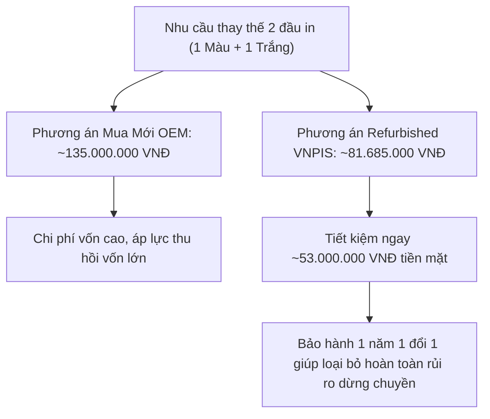

# So Sánh Đầu In Brother DTG Refurbished Và OEM New: Nên Mua Loại Nào Cho Xưởng In Áo Thun?

Khi đầu in máy in áo thun **Brother GTX, GTXpro hoặc GTXpro Bulk** gặp sự cố nghiêm trọng (mất tia diện rộng, cháy vi mạch điện tử, rách màng túi mực), chủ xưởng in thường đứng trước ngã ba đường: **Nên chi tiền mua đầu in OEM New mới 100% nguyên seal xuất xưởng, hay chọn giải pháp đầu in Refurbished (tân trang phục hồi kỹ thuật) để tối ưu hóa dòng tiền?**

Để trả lời khách quan câu hỏi này, **Kỹ Sư Trưởng Lưu Trọng Tâm** cùng đội ngũ R&D của VNPIS sẽ đặt cả hai phương án lên bàn cân kỹ thuật, so sánh trực tiếp từ cấu trúc vật lý, độ sắc nét tia phun đến bài toán hoàn vốn thực tế.

---

## 1. Đầu In Brother DTG Refurbished Là Gì?

Nhiều người thường nhầm lẫn giữa *"đầu in cũ thanh lý (Used)"* và *"đầu in tân trang đạt chuẩn kỹ thuật (Refurbished)"*:
- **Đầu in cũ trôi nổi (Used):** Là linh kiện tháo từ các máy in rã xác, không qua đo kiểm áp lực sóng xung Piezo, nguy cơ nghẽn mực hoặc lệch tia rất cao, không có chế độ bảo hành.
- **Đầu in Refurbished tại VNPIS:** Là các đầu in chính hãng Brother được thu hồi và đưa vào quy trình phục hồi nghiêm ngặt trong phòng Lab đạt chuẩn phòng sạch. Kỹ sư VNPIS sử dụng thiết bị tẩy rửa siêu âm đa tần số chuyên dụng, thông tắc các vi ống dẫn thạch anh, thay thế màng seal chống rò rỉ, và đo kiểm trên thiết bị mô phỏng xung áp.
  - Tiêu chuẩn xuất xưởng của VNPIS: **Tỷ lệ tia hoạt động (Nozzle) đạt $\ge 99\%$**.
  - Ngoại quan đạt: **90% – 97%** so với linh kiện xuất xưởng.
  - Điểm vượt trội nhất: Được áp dụng **chính sách bảo hành 1 năm 1 đổi 1** độc quyền khi kết hợp chương trình thu cũ đổi mới (xác minh online và gửi ngay đầu mới không cần chờ).

Quý khách có thể xem chi tiết thông số tại trang: [Đầu In Máy In Brother DTG GTX Chính Hãng](https://vnpis.com/products/printheads/brother-gtx).

---

## 2. Bảng So Sánh Kỹ Thuật Toàn Diện Giữa Refurbished Và OEM New

| Tiêu Chí So Sánh | Refurbished (Tân Trang Chính Hãng VNPIS) | OEM New (Mới 100% Nguyên Hộp) |
| :--- | :--- | :--- |
| **Nguồn gốc linh kiện** | Chính hãng Brother DTG được tái phục hồi kỹ thuật | Chính hãng Brother xuất xưởng nguyên seal |
| **Độ phủ tia (Nozzle Test)** | Đạt $\ge 99\%$ tia xả chuẩn, hạt mực tròn đều | Mới 100% nguyên bản |
| **Độ sắc nét bản in** | Tương đương 98% – 99% so với đầu in mới | 100% chuẩn quy chuẩn nhà máy Brother |
| **Ngoại quan sản phẩm** | 90% – 97% (có thể có vết gá lắp nhẹ bên ngoài vỏ) | 100% không tì vết |
| **Giá thành đầu in Màu (Color)** | **1.550 USD** *(~39.525.000 VNĐ)* | Đang cập nhật (Thường từ 2.400 – 2.600 USD) |
| **Giá thành đầu in Trắng (White)**| **1.650 USD** *(~42.160.000 VNĐ)* | Đang cập nhật (Thường từ 2.600 – 2.800 USD) |
| **Chế độ bảo hành** | **1 năm 1 đổi 1** *(khi tham gia gói thu cũ)* | Tiêu chuẩn nhà phân phối (thường ngắn hạn) |
| **Tính sẵn có tại kho** | **Luôn có sẵn hàng giao ngay trong ngày** | Phụ thuộc vào lịch nhập khẩu linh kiện |

---

## 3. Phân Tích Bài Toán Tài Chính & Thời Gian Hoàn Vốn (ROI)

Hãy làm một phép tính kinh tế cụ thể cho xưởng in quy mô vừa vận hành **2 máy Brother GTXpro**:

- **Chi phí tiết kiệm tức thì:** Khi chọn phương án Refurbished kèm chương trình Trade-in tại VNPIS, xưởng tiết kiệm ngay hơn **53 triệu đồng** cho mỗi cặp đầu in thay thế.
- **Tác động vào giá thành sản phẩm:** Tiết kiệm này tương đương với việc giảm chi phí khấu hao từ **5.000 – 8.000 VNĐ trên mỗi chiếc áo thun in**, tạo lợi thế cạnh tranh về giá vô cùng lớn khi đấu thầu đơn hàng may mặc xuất khẩu số lượng lớn.
- **Rủi ro vận hành bằng 0:** Khác với việc mua đầu mới bên ngoài bị từ chối bảo hành nếu dùng mực ngoài, gói bảo hành 1 năm 1 đổi 1 của VNPIS bảo đảm nếu đầu in gặp sự cố kỹ thuật trong diện bảo hành, khách chỉ cần quay tư liệu online và gửi mã tracking là được nhận ngay đầu in thay thế khác mà không cần chờ.

---

## 4. Xưởng Của Bạn Nên Chọn Phương Án Nào?

### Trường hợp NÊN chọn đầu in Refurbished:
1. Xưởng in thời trang thương mại, local brand, đơn hàng bán lẻ POD (Print on Demand) cần tối ưu hóa tối đa chi phí vận hành.
2. Xưởng in đang có đầu in cũ bị tắc hoặc hỏng nhưng chưa vứt bỏ – có thể dùng để tham gia chương trình thu cũ đổi mới nhận ưu đãi giá sâu.
3. Cần hàng gấp để giao đơn hàng trễ tiến độ, không thể chờ đợi thời gian đặt hàng từ nước ngoài.

### Trường hợp NÊN chọn đầu in OEM New:
1. Doanh nghiệp FDI hoặc nhà máy có quy định kiểm toán thiết bị nghiêm ngặt, bắt buộc 100% phụ tùng phải có chứng từ xuất xưởng mới hoàn toàn (Certificate of Origin / Quality).
2. Xưởng in nhận đơn hàng đòi hỏi độ phân giải vi mô đặc biệt khắt khe cho triển lãm hoặc sản phẩm mẫu cao cấp quốc tế.

---

## 5. Kết Luận & Khuyến Nghị

Cả hai phương án đều có giá trị riêng, nhưng với tỷ lệ hoàn thiện $\ge 99\%$ tia và chính sách bảo hành 1 năm 1 đổi 1 thu cũ đổi mới, **đầu in Brother DTG Refurbished tại VNPIS đang là giải pháp kinh tế thông minh và an toàn nhất hiện nay cho hơn 80% các xưởng in tại Việt Nam**.

Quý khách có nhu cầu kiểm tra tình trạng đầu in cũ hoặc nhận báo giá dự án, vui lòng liên hệ:
* **Chi tiết bảng giá:** [Bảng Giá Đầu In Brother DTG Mới Nhất](https://vnpis.com/blog/bang-gia-dau-in-brother-dtg-gtx-gtxpro-chinh-hang)
* **Trang sản phẩm:** [Đầu In Brother DTG GTX, GTXpro](https://vnpis.com/products/printheads/brother-gtx)
* **Kỹ Sư Trưởng tư vấn trực tiếp 24/7:** **0987 453 866**
